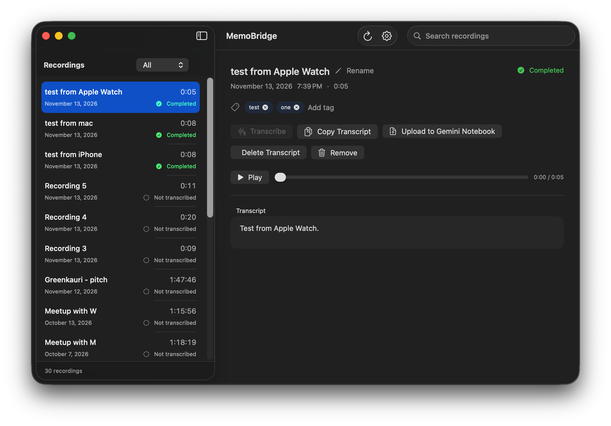
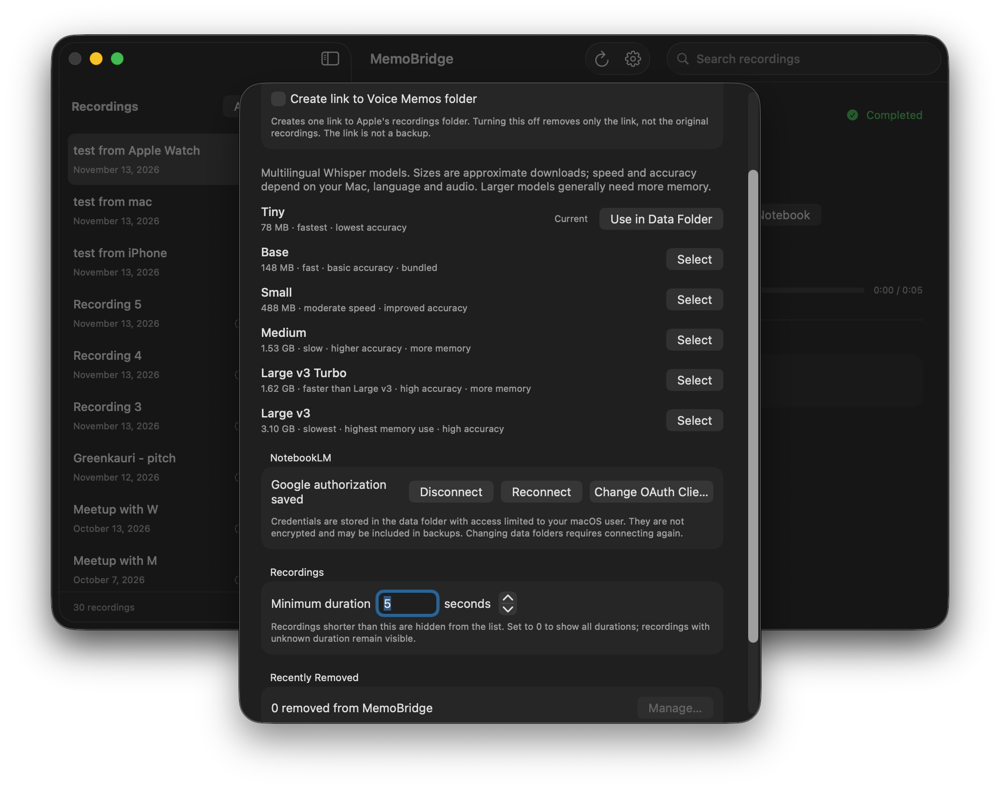
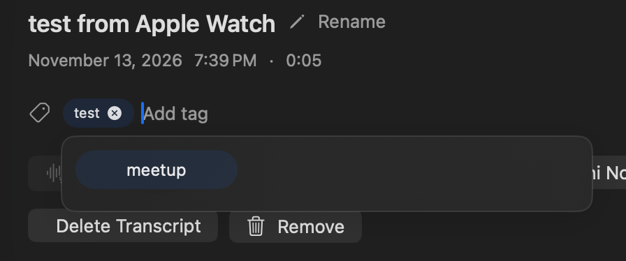
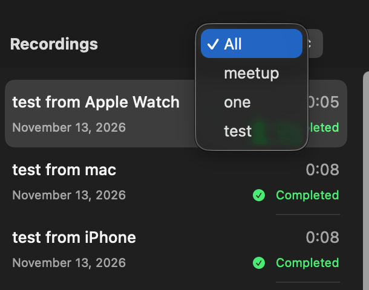
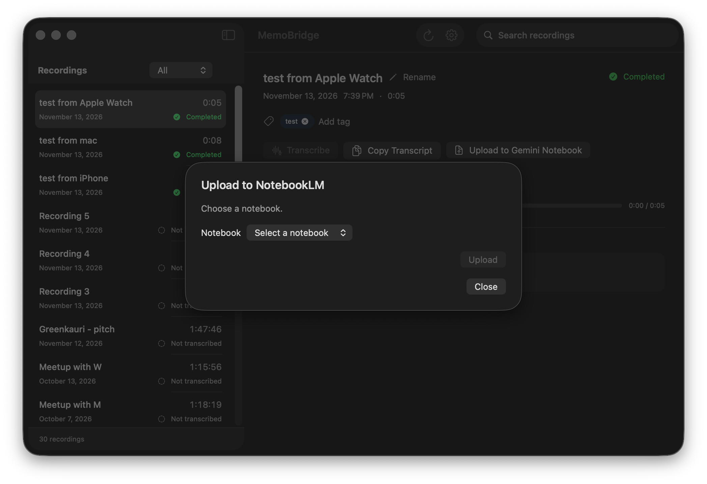
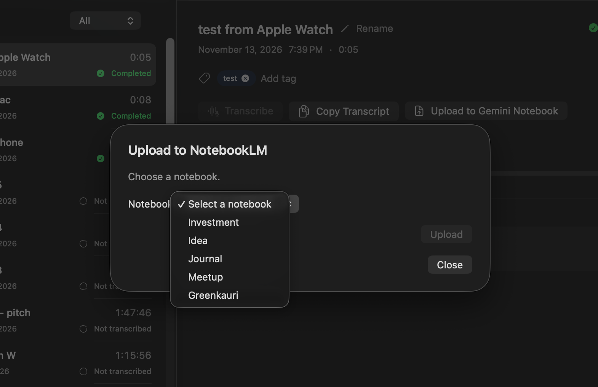

# MemoBridge

A native macOS app that turns Apple Voice Memos into organized, AI-ready transcripts.

- **Organize a cluttered library.** Add tags, rename recordings locally, and hide accidental short recordings with an adjustable duration filter.
- **Connect recordings to AI.** After a one-time Google OAuth setup, upload a transcript to a chosen Gemini Notebook (NotebookLM) from the app for AI-assisted organization. No API key is required.
- **Make meeting notes with older Apple devices.** Record with a compatible iPhone, Apple Watch, or Mac, then sync the recording to a Mac for local Whisper transcription—even when the recording device does not support Apple's built-in transcription. The Mac must run macOS 13 or later; older Macs, including Intel models, are supported where compatible. Hardware compatibility and performance need wider testing.

## See how it works

MemoBridge brings two parts of the workflow together: **manage recordings on your Mac**, then **connect their transcripts to an LLM** when you want to explore them further.

### Your recordings, in one place

Browse and search synced Voice Memos, play a recording, and transcribe it locally with Whisper. The detail view brings the recording, tags, transcript, and actions together. You can also rename a recording in MemoBridge or remove it from the list without changing the original in Apple Voice Memos.



### Settings that fit your workflow

Choose a Whisper model for your Mac and the accuracy you need, connect your Google account for optional NotebookLM uploads, and filter out recordings shorter than a chosen duration. You can also manage removed items and optionally create a link to the Voice Memos folder.



### Organize and find recordings with tags

Add a tag to a recording or select an existing suggestion. As you type, suggestions narrow to matching tags, making it easy to keep names consistent across your library.



Use the tag filter above the recording list to focus on one topic, such as meetings, ideas, or projects.



### Take transcripts further with NotebookLM

Once a recording has been transcribed, choose **Upload to Gemini Notebook**. After the one-time Google OAuth setup, you can send its transcript to NotebookLM without an API key. Uploading is optional; you can also copy the transcript for use with ChatGPT, Claude, or another tool.



Select an existing notebook to group related transcripts—for example, one notebook for a project and another for meeting notes. In NotebookLM, you can then ask questions across the sources, find relevant details, summarize discussions, or extract decisions and action items.



## Getting started

Requires macOS 13 or later and recordings available in Voice Memos. To build, install Xcode Command Line Tools, Git, CMake, and `curl`, then run:

```sh
bash scripts/setup_whisper.sh
bash scripts/build_app.sh
open dist/MemoBridge.app
```

The setup downloads and builds whisper.cpp and its multilingual Base model. The resulting app includes both; transcription runs locally. Builds are ad-hoc signed and not notarized. The application version is recorded in the project’s `VERSION` file.

If recordings cannot be read, enable MemoBridge under **System Settings → Privacy & Security → Full Disk Access**, then quit and reopen the app. This permission is broad. The app reads an undocumented Voice Memos database; sandbox and App Store compatibility have not been verified.

## Using MemoBridge

- Select a recording to play it or transcribe it. Focus the tag field to see existing tags; type a prefix to filter them, then select one to add it. Copy the transcript when needed.
- Renaming or removing a recording in MemoBridge does not change or delete the original Voice Memo. Restore removed items in **Settings → Recently Removed**; deleting a transcript moves only the local transcript to the Trash.
- Settings lets you choose a data folder, a Whisper model, and the minimum recording duration shown in the list. The default minimum is five seconds. If a transcription is running when you switch models, confirm to stop it before switching; no partial transcript is saved.
- To upload, first configure a Google Cloud project and desktop OAuth client in **Settings → NotebookLM**, then select a transcribed recording, choose **Upload to Gemini Notebook**, and select a notebook. See [Google's authentication documentation](https://developers.google.com/notebook/docs/authentication) for setup. Uploading is optional.

For one-shot batch transcription, run `./dist/memobridge`. It exits when finished; scheduling is optional. Command-line and scheduled permissions need separate verification. The list's duration filter does not apply to batch processing.

## Data and privacy

The default data folder is `~/memobridge`; you can change it in Settings.

```text
memobridge/
├── memo-index.sqlite3       Recording metadata, tags, names, and status
├── transcripts/             One JSON document per transcript; text is in `text`
├── models/                  Selected Whisper models
└── .credentials/            Optional NotebookLM credentials
```

Audio stays in Apple Voice Memos. The optional link to the recordings folder is off by default. Turning it off removes only the matching link, never the original recordings; other files or links are left untouched. The link is not a backup and does not bypass access permissions. App preferences are stored separately by macOS in `UserDefaults`, typically under `~/Library/Preferences/local.memobridge.app.plist`.

NotebookLM credentials are restricted to your macOS user but **not encrypted** and may be included in backups. Do not share or commit them. Disconnect in Settings to remove the local credential file.
